# Palmeiras · Onboarding · Índice de handoff

Uma pasta por tela, com `spec.md` (regras, ligações e critérios) e `screen.html` (marcação isolada). Comece por esta página, escolha o código da tela e leia só a pasta dela.

Precedência: **DS Palmeiras · Onboarding > spec.md > protótipo**. Dados compartilhados: [dados.md](dados.md). Componentes por tela e inventário: [componentes.md](componentes.md). Fonte do mapa: [flow.json](flow.json). Componentes do fluxo de estrangeiro: [componentes-estrangeiro.md](componentes-estrangeiro.md).

## Entrada e cadastro

Etapa 1 de 4 · dados pessoais, contatos e endereço

| Código | Tela | Status | Figma | Pasta |
|---|---|---|---|---|
| ENT-01 | Login | Desenhada | 1620:26870 | [ENT-01-login/](ENT-01-login/spec.md) |
| CAD-01 | Cadastro · Dados pessoais | Desenhada | 1619:11919 | [CAD-01-cadastro-dados-pessoais/](CAD-01-cadastro-dados-pessoais/spec.md) |
| CAD-02 | Código por SMS | Desenhada | 1620:29884 | [CAD-02-codigo-por-sms/](CAD-02-codigo-por-sms/spec.md) |
| CAD-03 | Editar celular | Sem Figma | — | [CAD-03-editar-celular/](CAD-03-editar-celular/spec.md) |
| CAD-04 | Código por e-mail | Desenhada | 1619:11471 | [CAD-04-codigo-por-e-mail/](CAD-04-codigo-por-e-mail/spec.md) |
| CAD-05 | Editar e-mail | Sem Figma | — | [CAD-05-editar-e-mail/](CAD-05-editar-e-mail/spec.md) |
| CAD-06 | E-mail verificado | Sem Figma | — | [CAD-06-e-mail-verificado/](CAD-06-e-mail-verificado/spec.md) |
| CAD-07 | Endereço | Desenhada | 1619:11471 | [CAD-07-endereco/](CAD-07-endereco/spec.md) |
| CAD-08 | Status · dados recebidos | Desenhada | 2198:23407 | [CAD-08-status-dados-recebidos/](CAD-08-status-dados-recebidos/spec.md) |

## Documento de identidade · brasileiro

Etapa 2 de 4 · CIN, CNH e RG

| Código | Tela | Status | Figma | Pasta |
|---|---|---|---|---|
| DOC-01 | Seleção de documento | Desenhada | 1928:61728 | [DOC-01-selecao-de-documento/](DOC-01-selecao-de-documento/spec.md) · 2 telas |
| DOC-G1 | Captura do documento | Lacuna, a desenhar | — | Foto ou upload da frente e do verso e conferência. Hoje os dois botões pulam direto para a biometria. |

## Documento de identidade · estrangeiro

Etapa 2 de 4 · uma linha por documento: CRNM, DPRNM, RNE, Cédula, Passaporte e erros de sistema · Figma 2283:33539

| Código | Tela | Status | Figma | Pasta |
|---|---|---|---|---|
| DOC-02 | Seleção do documento · estrangeiro | Desenhada | 2788:34526 | [DOC-02-selecao-documento-estrangeiro/](DOC-02-selecao-documento-estrangeiro/spec.md) · 6 telas |
| DOC-03 | CRNM · tutorial da frente | Desenhada | 2788:34545 | [DOC-03-crnm-tutorial-frente/](DOC-03-crnm-tutorial-frente/spec.md) · 3 telas |
| DOC-04 | CRNM · câmera da frente | Desenhada | 2788:34617 | [DOC-04-crnm-camera-frente/](DOC-04-crnm-camera-frente/spec.md) · 5 telas |
| DOC-05 | CRNM · confirmação da frente | Desenhada | 2788:34658 | [DOC-05-crnm-confirmacao-frente/](DOC-05-crnm-confirmacao-frente/spec.md) |
| DOC-06 | CRNM · tutorial do verso | Desenhada | 2788:34672 | [DOC-06-crnm-tutorial-verso/](DOC-06-crnm-tutorial-verso/spec.md) · 2 telas |
| DOC-07 | CRNM · câmera do verso (código) | Desenhada | 2788:34736 | [DOC-07-crnm-camera-verso/](DOC-07-crnm-camera-verso/spec.md) · 6 telas |
| DOC-09 | CRNM · upload da frente e do verso | Desenhada | 2788:37354 | [DOC-09-crnm-upload/](DOC-09-crnm-upload/spec.md) · 9 telas |
| DOC-10 | Status · documento recebido | Desenhada | 2283:34738 | [DOC-10-status-documento-recebido/](DOC-10-status-documento-recebido/spec.md) |
| DOC-11 | Falha na validação do documento | Desenhada | 2283:34313 | [DOC-11-falha-validacao-documento/](DOC-11-falha-validacao-documento/spec.md) · 3 telas |
| DOC-12 | Sem conexão ao enviar o documento | Proposta (sem Figma) | None | [DOC-12-sem-conexao/](DOC-12-sem-conexao/spec.md) · 3 telas |
| DOC-13 | Tempo excedido ao enviar o documento | Proposta (sem Figma) | None | [DOC-13-tempo-excedido/](DOC-13-tempo-excedido/spec.md) · 3 telas |
| DOC-14 | Erro inesperado ao enviar o documento | Proposta (sem Figma) | None | [DOC-14-erro-inesperado/](DOC-14-erro-inesperado/spec.md) · 3 telas |
| DOC-15 | Sessão expirada no documento | Proposta (sem Figma) | None | [DOC-15-sessao-expirada/](DOC-15-sessao-expirada/spec.md) |
| DOC-16 | DPRNM · tutorial da frente | Desenhada | 2794:35439 | [DOC-16-dprnm-tutorial-frente/](DOC-16-dprnm-tutorial-frente/spec.md) · 3 telas |
| DOC-17 | DPRNM · câmera da frente | Desenhada | 2794:35511 | [DOC-17-dprnm-camera-frente/](DOC-17-dprnm-camera-frente/spec.md) · 5 telas |
| DOC-18 | DPRNM · confirmação da frente | Desenhada | 2794:35552 | [DOC-18-dprnm-confirmacao-frente/](DOC-18-dprnm-confirmacao-frente/spec.md) |
| DOC-19 | DPRNM · tutorial do verso (QR Code) | Desenhada | 2794:35566 | [DOC-19-dprnm-tutorial-verso/](DOC-19-dprnm-tutorial-verso/spec.md) · 2 telas |
| DOC-20 | DPRNM · captura do código do verso | Desenhada | 2794:35630 | [DOC-20-dprnm-camera-verso/](DOC-20-dprnm-camera-verso/spec.md) · 6 telas |
| DOC-21 | DPRNM · upload da frente e do verso | Desenhada | 2794:35764 | [DOC-21-dprnm-upload/](DOC-21-dprnm-upload/spec.md) · 9 telas |
| DOC-22 | Os dados do documento não conferem | Proposta (sem Figma) | None | [DOC-22-dados-nao-conferem/](DOC-22-dados-nao-conferem/spec.md) · 3 telas |
| DOC-23 | Documento vencido | Proposta (sem Figma) | None | [DOC-23-documento-vencido/](DOC-23-documento-vencido/spec.md) |
| DOC-24 | Conclusão do fluxo de documento | Desenhada | 2283:34738 | [DOC-24-documento-em-analise/](DOC-24-documento-em-analise/spec.md) |
| DOC-25 | Bloqueio por tentativas no documento | Proposta (sem Figma) | None | [DOC-25-bloqueio-tentativas/](DOC-25-bloqueio-tentativas/spec.md) |
| DOC-26 | RNE · tutorial da frente | Desenhada | 1817:51415 | [DOC-26-rne-tutorial-frente/](DOC-26-rne-tutorial-frente/spec.md) · 3 telas |
| DOC-27 | RNE · câmera da frente | Desenhada | 1620:12173 | [DOC-27-rne-camera-frente/](DOC-27-rne-camera-frente/spec.md) · 5 telas |
| DOC-28 | RNE · confirmação da frente | Desenhada | 1620:12658 | [DOC-28-rne-confirmacao-frente/](DOC-28-rne-confirmacao-frente/spec.md) |
| DOC-29 | RNE · tutorial do verso (código) | Desenhada | 1620:13673 | [DOC-29-rne-tutorial-verso/](DOC-29-rne-tutorial-verso/spec.md) · 2 telas |
| DOC-30 | RNE · leitura do código MRZ (verso) | Desenhada | 2169:22442 | [DOC-30-rne-camera-verso/](DOC-30-rne-camera-verso/spec.md) · 6 telas |
| DOC-31 | RNE · upload da frente e do verso | Desenhada | 1620:13176 | [DOC-31-rne-upload/](DOC-31-rne-upload/spec.md) · 9 telas |
| DOC-32 | Cédula · formulário | Desenhada | 2799:36191 | [DOC-32-cedula-formulario/](DOC-32-cedula-formulario/spec.md) · 4 telas |
| DOC-33 | Cédula · tutorial da frente | Desenhada | 2799:36264 | [DOC-33-cedula-tutorial-frente/](DOC-33-cedula-tutorial-frente/spec.md) · 3 telas |
| DOC-34 | Cédula · câmera da frente | Desenhada | 2799:36336 | [DOC-34-cedula-camera-frente/](DOC-34-cedula-camera-frente/spec.md) · 5 telas |
| DOC-35 | Cédula · confirmação da frente | Desenhada | 2799:36377 | [DOC-35-cedula-confirmacao-frente/](DOC-35-cedula-confirmacao-frente/spec.md) |
| DOC-36 | Cédula · tutorial do verso | Desenhada | 2799:36391 | [DOC-36-cedula-tutorial-verso/](DOC-36-cedula-tutorial-verso/spec.md) · 2 telas |
| DOC-37 | Cédula · câmera do verso | Desenhada | 2799:36455 | [DOC-37-cedula-camera-verso/](DOC-37-cedula-camera-verso/spec.md) · 5 telas |
| DOC-38 | Cédula · confirmação do verso | Desenhada | 2799:36504 | [DOC-38-cedula-confirmacao-verso/](DOC-38-cedula-confirmacao-verso/spec.md) |
| DOC-39 | Passaporte · tutorial da página | Proposta (sem Figma) | None | [DOC-39-passaporte-tutorial-pagina/](DOC-39-passaporte-tutorial-pagina/spec.md) · 3 telas |
| DOC-40 | Passaporte · câmera da página | Proposta (sem Figma) | None | [DOC-40-passaporte-camera-pagina/](DOC-40-passaporte-camera-pagina/spec.md) · 5 telas |
| DOC-41 | Passaporte · confirmação da página | Proposta (sem Figma) | None | [DOC-41-passaporte-confirmacao-pagina/](DOC-41-passaporte-confirmacao-pagina/spec.md) |
| DOC-42 | Passaporte · tutorial do código | Proposta (sem Figma) | None | [DOC-42-passaporte-tutorial-codigo/](DOC-42-passaporte-tutorial-codigo/spec.md) · 2 telas |
| DOC-43 | Passaporte · leitura do código MRZ | Proposta (sem Figma) | None | [DOC-43-passaporte-camera-mrz/](DOC-43-passaporte-camera-mrz/spec.md) · 6 telas |
| DOC-44 | Passaporte · confirmação do código | Proposta (sem Figma) | None | [DOC-44-passaporte-confirmacao-mrz/](DOC-44-passaporte-confirmacao-mrz/spec.md) |
| DOC-45 | Passaporte · página errada | Proposta (sem Figma) | None | [DOC-45-passaporte-pagina-errada/](DOC-45-passaporte-pagina-errada/spec.md) |
| DOC-46 | Passaporte · código não encontrado | Proposta (sem Figma) | None | [DOC-46-passaporte-mrz-nao-encontrado/](DOC-46-passaporte-mrz-nao-encontrado/spec.md) |

## Biometria facial

Etapa 3 de 4 · validação facial · Figma 1774:46029

| Código | Tela | Status | Figma | Pasta |
|---|---|---|---|---|
| BIO-01 | Tutorial da captura | Desenhada | 1774:46320 | [BIO-01-tutorial-da-captura/](BIO-01-tutorial-da-captura/spec.md) · 4 telas |
| BIO-02 | Captura facial | Desenhada | 1774:46144 | [BIO-02-captura-facial/](BIO-02-captura-facial/spec.md) · 13 telas |
| BIO-03 | Validando a foto | Desenhada | 1774:46292 | [BIO-03-validando-a-foto/](BIO-03-validando-a-foto/spec.md) |
| BIO-04 | Conferência da foto | Desenhada | 1774:46253 | [BIO-04-conferencia-da-foto/](BIO-04-conferencia-da-foto/spec.md) |
| BIO-07 | Status · identidade enviada | Desenhada | 2602:31414 | [BIO-07-status-identidade-enviada/](BIO-07-status-identidade-enviada/spec.md) |
| BEN-G1 | Validação de benefícios | Lacuna, a desenhar | — | Etapa 4 de 4. A próxima etapa vem do backend; no protótipo o fluxo cai na área logada. |
| BIO-05 | Bloqueio · 3 tentativas | Sem Figma | — | [BIO-05-bloqueio-3-tentativas/](BIO-05-bloqueio-3-tentativas/spec.md) |
| BIO-06 | Erro com suporte | Sem Figma | — | [BIO-06-erro-com-suporte/](BIO-06-erro-com-suporte/spec.md) |

## Área logada

Meu cadastro, notificações, ajuda e segurança

| Código | Tela | Status | Figma | Pasta |
|---|---|---|---|---|
| AREA-01 | Meu cadastro · 13 variantes de cenário | Desenhada | 2831:36859 | [AREA-01-meu-cadastro/](AREA-01-meu-cadastro/spec.md) |
| AREA-02 | Notificações | Sem Figma | — | [AREA-02-notificacoes/](AREA-02-notificacoes/spec.md) |
| AJD-01 | Ajuda · abrir chamado | Sem Figma | — | [AJD-01-ajuda-abrir-chamado/](AJD-01-ajuda-abrir-chamado/spec.md) |
| AJD-02 | Ajuda · chamado aberto | Sem Figma | — | [AJD-02-ajuda-chamado-aberto/](AJD-02-ajuda-chamado-aberto/spec.md) |
| AREA-03 | Segurança | Desenhada | 3142:61656 | [AREA-03-seguranca/](AREA-03-seguranca/spec.md) |
| AREA-04 | Encerrar conta | Desenhada | 3142:61697 | [AREA-04-encerrar-conta/](AREA-04-encerrar-conta/spec.md) |

## Familiares

Inclusão e gestão de vínculos

| Código | Tela | Status | Figma | Pasta |
|---|---|---|---|---|
| FAM-01 | Meus familiares · vazio | Desenhada | 2831:38227 | [FAM-01-meus-familiares-vazio/](FAM-01-meus-familiares-vazio/spec.md) |
| FAM-03 | Adicionar familiar · introdução | Desenhada | 3057:44465 | [FAM-03-adicionar-familiar-introducao/](FAM-03-adicionar-familiar-introducao/spec.md) |
| FAM-09 | Buscar familiar | Sem Figma | — | [FAM-09-buscar-familiar/](FAM-09-buscar-familiar/spec.md) |
| FAM-10 | Card e tipo de vínculo | Sem Figma | — | [FAM-10-card-e-tipo-de-vinculo/](FAM-10-card-e-tipo-de-vinculo/spec.md) |
| FAM-11 | Confirmação de contatos e convite | Sem Figma | — | [FAM-11-confirmacao-de-contatos-e-convite/](FAM-11-confirmacao-de-contatos-e-convite/spec.md) |
| FAM-12 | Cadastro do familiar (sem conta) | Sem Figma | — | [FAM-12-cadastro-do-familiar-sem-conta/](FAM-12-cadastro-do-familiar-sem-conta/spec.md) |
| FAM-13 | Termo de responsabilidade · menor | Sem Figma | — | [FAM-13-termo-de-responsabilidade-menor/](FAM-13-termo-de-responsabilidade-menor/spec.md) |
| FAM-15 | Código do contato do familiar | Aprovada; estados pendentes | — | [FAM-15-codigo-do-contato-do-familiar/](FAM-15-codigo-do-contato-do-familiar/spec.md) |
| FAM-G2 | Preenchimento e capturas no celular do titular | Aprovada (passo 1 · tutorial DOC-03, botão lv-fill) | — | [FAM-G2-preparacao-do-cadastro/](FAM-G2-preparacao-do-cadastro/spec.md) · Documento, liveness e criação de senha feitos no celular do titular, em nome do familiar (spec §6.2 e §6.5). Não desenhado: no protótipo o fluxo não passa daqui. |
| FAM-G2 | Captura da frente do documento do familiar | Aprovada (passo 2 · câmera de DOC-04) | — | [FAM-G2-captura-do-documento/](FAM-G2-captura-do-documento/spec.md) · Variante familiar de DOC-G1. |
| FAM-G2 | Confirmação da frente do documento do familiar | Proposta, a validar (passo 3 · conferência de BIO-04) | — | [FAM-G2-confirmacao-da-frente/](FAM-G2-confirmacao-da-frente/spec.md) |
| FAM-G2 | Captura do verso do documento do familiar | Proposta, a validar (passo 4 · câmera da frente) | — | [FAM-G2-captura-do-verso/](FAM-G2-captura-do-verso/spec.md) |
| FAM-G2 | Seleção do documento do familiar (CIN, CNH e RG; menor só CIN e RG) | Aprovada (passo 0 · antes do tutorial) | — | [FAM-G2-selecao-do-documento/](FAM-G2-selecao-do-documento/spec.md) · 2 telas |
| FAM-G2 | CIN · tutorial da frente do familiar | Aprovada (versão CIN · passo 1) | — | [FAM-G2-cin-tutorial-frente/](FAM-G2-cin-tutorial-frente/spec.md) |
| FAM-G2 | CIN · captura da frente do familiar | Aprovada (versão CIN · passo 2) | — | [FAM-G2-cin-captura-frente/](FAM-G2-cin-captura-frente/spec.md) |
| FAM-G2 | CIN · captura do verso do familiar | Aprovada (versão CIN · passo 3) | — | [FAM-G2-cin-captura-verso/](FAM-G2-cin-captura-verso/spec.md) |
| FAM-14 | Decisão do titular · maior de idade | Sem Figma | — | [FAM-14-decisao-do-titular-maior-de-idade/](FAM-14-decisao-do-titular-maior-de-idade/spec.md) |
| FAM-16 | Convite · entrada pelo link (sem conta) | Sem Figma | — | [FAM-16-convite-entrada-pelo-link-sem-conta/](FAM-16-convite-entrada-pelo-link-sem-conta/spec.md) |
| FAM-18 | Convite indisponível (expirado, cancelado ou já usado) | Aprovada | — | [FAM-18-convite-indisponivel/](FAM-18-convite-indisponivel/spec.md) |
| FAM-19 | Cancelar convite (modal) | Aprovada | — | [FAM-19-cancelar-convite/](FAM-19-cancelar-convite/spec.md) |
| FAM-20 | Meus familiares · erro ao carregar | Proposta, a validar | — | [FAM-20-erro-ao-carregar-familiares/](FAM-20-erro-ao-carregar-familiares/spec.md) |
| FAM-17 | Área do convidado · Meus familiares e Sou familiar de | Sem Figma | — | [FAM-17-area-do-convidado-meus-familiares-e-sou-familiar-de/](FAM-17-area-do-convidado-meus-familiares-e-sou-familiar-de/spec.md) |

## Decisões

- **DEC-01 · Código SMS correto?** Avaliada em CAD-02 quando o 6º dígito é digitado. Sim: sucesso e CAD-04. Não: erro com tentativas restantes; no 3º erro, bloqueio.
- **DEC-02 · Código e-mail correto?** Avaliada em CAD-04 quando o 6º dígito é digitado. Sim: sucesso e CAD-06. Não: erro; no 3º, bloqueio.
- **DEC-03 · Rosto aprovado?** Avaliada em BIO-02 com o rosto na moldura. Aprovado: contagem e BIO-03. Reprovado: avisos e nova tentativa; na 3ª reprovação, BIO-05.

## Fluxo completo

```mermaid
flowchart LR
  subgraph cadastro["Entrada e cadastro"]
    ENT_01["ENT-01<br/>Login"]
    CAD_01["CAD-01<br/>Cadastro · Dados pessoais"]
    CAD_02["CAD-02<br/>Código por SMS"]
    CAD_03["CAD-03<br/>Editar celular"]
    DEC_01{"DEC-01<br/>Código SMS correto?"}
    CAD_04["CAD-04<br/>Código por e-mail"]
    CAD_05["CAD-05<br/>Editar e-mail"]
    DEC_02{"DEC-02<br/>Código e-mail correto?"}
    CAD_06["CAD-06<br/>E-mail verificado"]
    CAD_07["CAD-07<br/>Endereço"]
    CAD_08["CAD-08<br/>Status · dados recebidos"]
  end
  subgraph documento["Documento de identidade · brasileiro"]
    DOC_01["DOC-01<br/>Seleção de documento"]
    DOC_G1["DOC-G1<br/>Captura do documento"]:::gap
  end
  subgraph estrangeiro["Documento de identidade · estrangeiro"]
    DOC_02["DOC-02<br/>Seleção do documento · estrangeiro"]
    DOC_03["DOC-03<br/>CRNM · tutorial da frente"]
    DOC_04["DOC-04<br/>CRNM · câmera da frente"]
    DOC_05["DOC-05<br/>CRNM · confirmação da frente"]
    DOC_06["DOC-06<br/>CRNM · tutorial do verso"]
    DOC_07["DOC-07<br/>CRNM · câmera do verso (código)"]
    DOC_09["DOC-09<br/>CRNM · upload da frente e do verso"]
    DOC_10["DOC-10<br/>Status · documento recebido"]
    DOC_11["DOC-11<br/>Falha na validação do documento"]
    DOC_12["DOC-12<br/>Sem conexão ao enviar o documento"]
    DOC_13["DOC-13<br/>Tempo excedido ao enviar o documento"]
    DOC_14["DOC-14<br/>Erro inesperado ao enviar o documento"]
    DOC_15["DOC-15<br/>Sessão expirada no documento"]
    DOC_16["DOC-16<br/>DPRNM · tutorial da frente"]
    DOC_17["DOC-17<br/>DPRNM · câmera da frente"]
    DOC_18["DOC-18<br/>DPRNM · confirmação da frente"]
    DOC_19["DOC-19<br/>DPRNM · tutorial do verso (QR Code)"]
    DOC_20["DOC-20<br/>DPRNM · captura do código do verso"]
    DOC_21["DOC-21<br/>DPRNM · upload da frente e do verso"]
    DOC_22["DOC-22<br/>Os dados do documento não conferem"]
    DOC_23["DOC-23<br/>Documento vencido"]
    DOC_24["DOC-24<br/>Conclusão do fluxo de documento"]
    DOC_25["DOC-25<br/>Bloqueio por tentativas no documento"]
    DOC_26["DOC-26<br/>RNE · tutorial da frente"]
    DOC_27["DOC-27<br/>RNE · câmera da frente"]
    DOC_28["DOC-28<br/>RNE · confirmação da frente"]
    DOC_29["DOC-29<br/>RNE · tutorial do verso (código)"]
    DOC_30["DOC-30<br/>RNE · leitura do código MRZ (verso)"]
    DOC_31["DOC-31<br/>RNE · upload da frente e do verso"]
    DOC_32["DOC-32<br/>Cédula · formulário"]
    DOC_33["DOC-33<br/>Cédula · tutorial da frente"]
    DOC_34["DOC-34<br/>Cédula · câmera da frente"]
    DOC_35["DOC-35<br/>Cédula · confirmação da frente"]
    DOC_36["DOC-36<br/>Cédula · tutorial do verso"]
    DOC_37["DOC-37<br/>Cédula · câmera do verso"]
    DOC_38["DOC-38<br/>Cédula · confirmação do verso"]
    DOC_39["DOC-39<br/>Passaporte · tutorial da página"]
    DOC_40["DOC-40<br/>Passaporte · câmera da página"]
    DOC_41["DOC-41<br/>Passaporte · confirmação da página"]
    DOC_42["DOC-42<br/>Passaporte · tutorial do código"]
    DOC_43["DOC-43<br/>Passaporte · leitura do código MRZ"]
    DOC_44["DOC-44<br/>Passaporte · confirmação do código"]
    DOC_45["DOC-45<br/>Passaporte · página errada"]
    DOC_46["DOC-46<br/>Passaporte · código não encontrado"]
  end
  subgraph biometria["Biometria facial"]
    BIO_01["BIO-01<br/>Tutorial da captura"]
    BIO_02["BIO-02<br/>Captura facial"]
    DEC_03{"DEC-03<br/>Rosto aprovado?"}
    BIO_03["BIO-03<br/>Validando a foto"]
    BIO_04["BIO-04<br/>Conferência da foto"]
    BIO_07["BIO-07<br/>Status · identidade enviada"]
    BEN_G1["BEN-G1<br/>Validação de benefícios"]:::gap
    BIO_05["BIO-05<br/>Bloqueio · 3 tentativas"]
    BIO_06["BIO-06<br/>Erro com suporte"]
  end
  subgraph area["Área logada"]
    AREA_01["AREA-01<br/>Meu cadastro"]
    AREA_02["AREA-02<br/>Notificações"]
    AJD_01["AJD-01<br/>Ajuda · abrir chamado"]
    AJD_02["AJD-02<br/>Ajuda · chamado aberto"]
    AREA_03["AREA-03<br/>Segurança"]
    AREA_04["AREA-04<br/>Encerrar conta"]
  end
  subgraph familiares["Familiares"]
    FAM_01["FAM-01<br/>Meus familiares · vazio"]
    FAM_03["FAM-03<br/>Adicionar familiar · introdução"]
    FAM_09["FAM-09<br/>Buscar familiar"]
    FAM_10["FAM-10<br/>Card e tipo de vínculo"]
    FAM_11["FAM-11<br/>Confirmação de contatos e convite"]
    FAM_12["FAM-12<br/>Cadastro do familiar (sem conta)"]
    FAM_13["FAM-13<br/>Termo de responsabilidade · menor"]
    FAM_14["FAM-14<br/>Decisão do titular · maior de idade"]
    FAM_16["FAM-16<br/>Convite · entrada pelo link (sem conta)"]
    FAM_17["FAM-17<br/>Área do convidado · Meus familiares e Sou familiar de"]
    FAM_15["FAM-15<br/>Código do contato do familiar"]
    FAM_18["FAM-18<br/>Convite indisponível (expirado, cancelado ou já usado)"]
    FAM_19["FAM-19<br/>Cancelar convite (modal)"]
    FAM_G2_1["FAM-G2-1<br/>FAM-G2 · Tutorial da captura do familiar"]
    FAM_G2_2["FAM-G2-2<br/>FAM-G2 · Captura da frente do documento do familiar"]
    FAM_G2_3["FAM-G2-3<br/>FAM-G2 · Confirmação da frente do documento"]
    FAM_G2_4["FAM-G2-4<br/>FAM-G2 · Captura do verso do documento do familiar"]
    FAM_G2_5["FAM-G2-5<br/>FAM-G2 · Confirmação do verso (a desenhar)"]:::gap
    FAM_G2_0["FAM-G2-0<br/>FAM-G2 · Seleção do documento do familiar"]
    FAM_G2_CIN_1["FAM-G2-CIN-1<br/>FAM-G2 · CIN · tutorial da frente do familiar"]
    FAM_G2_CIN_2["FAM-G2-CIN-2<br/>FAM-G2 · CIN · captura da frente do familiar"]
    FAM_G2_CIN_3["FAM-G2-CIN-3<br/>FAM-G2 · CIN · captura do verso do familiar"]
    FAM_20["FAM-20<br/>Meus familiares · erro ao carregar"]
  end
  ENT_01 -->|"Entrar"| AREA_01
  ENT_01 -->|"Criar cadastro"| CAD_01
  CAD_01 -->|"Iniciar validação"| CAD_02
  CAD_02 -->|"6º dígito digitado"| DEC_01
  DEC_01 -->|"Sim · após 1,8 s"| CAD_04
  DEC_01 -.->|"Não · tenta de novo"| CAD_02
  CAD_02 -->|"Editar celular"| CAD_03
  CAD_03 -->|"Confirmar e enviar código"| CAD_02
  CAD_04 -->|"6º dígito digitado"| DEC_02
  DEC_02 -->|"Sim · após 1,8 s"| CAD_06
  DEC_02 -.->|"Não · tenta de novo"| CAD_04
  CAD_04 -->|"Editar e-mail"| CAD_05
  CAD_05 -->|"Confirmar e enviar código"| CAD_04
  CAD_06 -->|"Continuar"| CAD_07
  CAD_07 -->|"Continuar"| CAD_08
  CAD_08 ==>|"10 s ou Continuar agora"| DOC_01
  DOC_01 -->|"Tirar foto ou Fazer upload"| BIO_01
  DOC_01 -.->|"Tirar foto ou Fazer upload"| DOC_G1
  DOC_G1 -.->|"Documento aprovado"| BIO_01
  BIO_01 -->|"Continuar no 3º passo"| BIO_02
  BIO_02 -->|"Rosto enquadrado na moldura"| DEC_03
  DEC_03 -->|"Aprovado · contagem 3, 2, 1"| BIO_03
  DEC_03 -.->|"Reprovado · avisos e nova tentativa"| BIO_02
  DEC_03 -.->|"3ª reprovação"| BIO_05
  BIO_03 ==>|"Após 2 s"| BIO_04
  BIO_04 -->|"Salvar e continuar"| BIO_07
  BIO_04 -->|"Tirar outra foto"| BIO_02
  BIO_05 ==>|"Fim do bloqueio de 5 min"| BIO_06
  BIO_05 -.->|"Sair e continuar depois"| ENT_01
  BIO_06 -.->|"Sair e continuar depois"| ENT_01
  BIO_07 ==>|"10 s ou Continuar agora"| AREA_01
  BIO_07 -.->|"Próxima etapa definida pelo backend"| BEN_G1
  AREA_01 -->|"Sino de notificações"| AREA_02
  AREA_01 -->|"Ajuda e atendimento"| AJD_01
  AREA_01 -->|"Menu › Segurança"| AREA_03
  AREA_01 -.->|"Menu › Sair"| ENT_01
  FAM_03 -->|"Adicionar familiar"| FAM_09
  FAM_09 -->|"Conta ativa encontrada"| FAM_10
  FAM_09 -->|"Cadastrar novo familiar"| FAM_12
  FAM_10 -->|"Prosseguir"| FAM_11
  FAM_11 -->|"Enviar convite"| FAM_17
  FAM_14 -->|"Enviar convite"| FAM_11
  FAM_11 -->|"Convidado abre o link do convite"| FAM_16
  FAM_16 -->|"Continuar"| CAD_01
  FAM_16 -->|"Já tenho conta"| ENT_01
  AREA_01 -->|"Aba Meus familiares"| FAM_01
  AREA_01 -->|"Aba Meus familiares"| FAM_17
  AREA_01 -->|"Concluir validação ou Tentar novamente"| DOC_01
  AJD_01 -->|"Abrir chamado"| AJD_02
  AJD_02 -->|"Voltar para a área logada ou Fechar"| AREA_01
  AREA_03 -->|"Encerrar conta"| AREA_04
  AREA_04 -->|"Encerrar conta"| ENT_01
  FAM_01 -->|"Incluir novo familiar"| FAM_03
  FAM_01 -->|"Aba Meu cadastro"| AREA_01
  FAM_17 -->|"Incluir novo familiar"| FAM_03
  FAM_17 ==>|"Desvincular o último familiar"| FAM_01
  FAM_17 -->|"Aba Meu cadastro"| AREA_01
  FAM_G2_2 -->|"Foto tirada"| FAM_G2_3
  FAM_G2_3 -->|"Tirar outra foto"| FAM_G2_CIN_2
  FAM_16 -.->|"Link expirado, cancelado ou já usado"| FAM_18
  FAM_19 -->|"Cancelar convite"| FAM_17
  FAM_G2_4 -->|"Foto tirada"| FAM_G2_5
  FAM_13 -->|"Aceitar termo"| FAM_G2_0
  FAM_14 -->|"Cadastrar agora"| FAM_G2_0
  FAM_G2_CIN_1 -->|"Abrir câmera ou Pular"| FAM_G2_CIN_2
  FAM_G2_CIN_2 -->|"Foto tirada"| FAM_G2_3
  FAM_G2_3 -->|"Salvar e continuar"| FAM_G2_CIN_3
  CAD_08 ==>|"10 s ou Continuar agora"| DOC_02
  DOC_02 -->|"CRNM · Tirar foto do documento"| DOC_03
  DOC_03 -->|"Abrir câmera ou Pular"| DOC_04
  DOC_04 -->|"Voltar para a seleção"| DOC_02
  DOC_04 -->|"Foto tirada"| DOC_05
  DOC_05 -->|"Tirar outra foto ou Voltar"| DOC_04
  DOC_05 -->|"Continuar"| DOC_06
  DOC_06 -->|"Abrir câmera ou Pular"| DOC_07
  DOC_07 -->|"Voltar para a seleção"| DOC_02
  DOC_07 ==>|"Código MRZ lido e validado via API"| BIO_01
  DOC_02 -->|"CRNM · Fazer upload do documento"| DOC_09
  DOC_09 -->|"Enviar documento"| DOC_10
  DOC_10 ==>|"10 s ou Continuar agora"| BIO_01
  DOC_10 -.->|"Validação do documento reprovada"| DOC_11
  DOC_11 -->|"Tentar novamente"| DOC_09
  DOC_09 -.->|"Enviar documento sem conexão"| DOC_12
  DOC_12 -->|"Tentar novamente"| DOC_09
  DOC_09 -.->|"Envio acima de 20 s"| DOC_13
  DOC_13 -->|"Tentar novamente"| DOC_09
  DOC_09 -.->|"Erro inesperado no envio"| DOC_14
  DOC_14 -->|"Tentar novamente"| DOC_09
  DOC_09 -.->|"Sessão expirada no envio"| DOC_15
  DOC_15 -.->|"Entrar"| ENT_01
  DOC_02 -->|"DPRNM · Tirar foto do documento"| DOC_16
  DOC_16 -->|"Abrir câmera ou Pular"| DOC_17
  DOC_17 -->|"Voltar para a seleção"| DOC_02
  DOC_17 -->|"Foto tirada"| DOC_18
  DOC_18 -->|"Tirar outra foto ou Voltar"| DOC_17
  DOC_18 -->|"Continuar"| DOC_19
  DOC_19 -->|"Abrir câmera ou Pular"| DOC_20
  DOC_20 -->|"Voltar para a seleção"| DOC_02
  DOC_20 ==>|"QR Code lido por OCR"| BIO_01
  DOC_02 -->|"DPRNM · Fazer upload do documento"| DOC_21
  DOC_21 -->|"Enviar documento"| DOC_10
  DOC_21 -.->|"Sem conexão ao enviar (DPRNM)"| DOC_12
  DOC_21 -.->|"Envio acima de 20 s (DPRNM)"| DOC_13
  DOC_21 -.->|"Erro inesperado no envio (DPRNM)"| DOC_14
  DOC_21 -.->|"Sessão expirada no envio (DPRNM)"| DOC_15
  DOC_10 -.->|"Dados lidos não conferem com os informados"| DOC_22
  DOC_22 -->|"Revisar dados informados"| DOC_02
  DOC_22 -->|"Enviar novos arquivos"| DOC_09
  DOC_10 -.->|"Validade impressa já passou"| DOC_23
  DOC_23 -->|"Escolher outro documento"| DOC_02
  DOC_10 -->|"Documento aprovado"| DOC_24
  DOC_24 ==>|"10 s ou Continuar agora"| BIO_01
  DOC_11 -.->|"Terceira validação reprovada"| DOC_25
  DOC_25 -.->|"Sair e continuar depois"| ENT_01
  DOC_02 -->|"RNE · Tirar foto do documento"| DOC_26
  DOC_26 -->|"Abrir câmera ou Pular"| DOC_27
  DOC_27 -->|"Voltar para a seleção"| DOC_02
  DOC_27 -->|"Foto tirada"| DOC_28
  DOC_28 -->|"Tirar outra foto ou Voltar"| DOC_27
  DOC_28 -->|"Continuar"| DOC_29
  DOC_29 -->|"Abrir câmera ou Pular"| DOC_30
  DOC_30 -->|"Voltar para a seleção"| DOC_02
  DOC_30 ==>|"Código MRZ lido e validado via API"| BIO_01
  DOC_02 -->|"RNE · Fazer upload do documento"| DOC_31
  DOC_31 -->|"Enviar documento"| DOC_10
  DOC_31 -.->|"Sem conexão ao enviar (RNE)"| DOC_12
  DOC_31 -.->|"Envio acima de 20 s (RNE)"| DOC_13
  DOC_31 -.->|"Erro inesperado no envio (RNE)"| DOC_14
  DOC_31 -.->|"Sessão expirada no envio (RNE)"| DOC_15
  DOC_02 -->|"Cédula · Tirar foto do documento"| DOC_32
  DOC_32 -->|"Continuar"| DOC_33
  DOC_33 -->|"Abrir câmera ou Pular"| DOC_34
  DOC_34 -->|"Voltar para a seleção"| DOC_02
  DOC_34 -->|"Foto tirada"| DOC_35
  DOC_35 -->|"Tirar outra foto ou Voltar"| DOC_34
  DOC_35 -->|"Continuar"| DOC_36
  DOC_36 -->|"Abrir câmera ou Pular"| DOC_37
  DOC_37 -->|"Foto tirada"| DOC_38
  DOC_37 -->|"Voltar para a seleção"| DOC_02
  DOC_38 -->|"Tirar outra foto ou Voltar"| DOC_37
  DOC_38 -->|"Continuar"| DOC_10
  DOC_02 -->|"Passaporte · Tirar foto do documento"| DOC_39
  DOC_39 -->|"Abrir câmera ou Pular"| DOC_40
  DOC_40 -->|"Voltar para a seleção"| DOC_02
  DOC_40 -->|"Foto tirada"| DOC_41
  DOC_40 -.->|"Página errada do passaporte"| DOC_45
  DOC_41 -->|"Tirar outra foto ou Voltar"| DOC_40
  DOC_41 -->|"Continuar"| DOC_42
  DOC_42 -->|"Abrir câmera ou Pular"| DOC_43
  DOC_43 -->|"Código MRZ capturado"| DOC_44
  DOC_43 -.->|"Código MRZ não encontrado"| DOC_46
  DOC_43 -->|"Voltar para a seleção"| DOC_02
  DOC_44 -->|"Tirar outra foto ou Voltar"| DOC_43
  DOC_44 -->|"Continuar"| DOC_10
  DOC_45 -->|"Tirar outra foto"| DOC_40
  DOC_46 -->|"Tirar outra foto"| DOC_43
  DOC_11 -->|"Tentar novamente"| DOC_21
  DOC_11 -->|"Tentar novamente"| DOC_31
  DOC_12 -->|"Tentar novamente"| DOC_21
  DOC_12 -->|"Tentar novamente"| DOC_31
  DOC_13 -->|"Tentar novamente"| DOC_21
  DOC_13 -->|"Tentar novamente"| DOC_31
  DOC_14 -->|"Tentar novamente"| DOC_21
  DOC_14 -->|"Tentar novamente"| DOC_31
  DOC_22 -->|"Enviar novos arquivos"| DOC_21
  DOC_22 -->|"Enviar novos arquivos"| DOC_31
  DOC_22 -.->|"Terceira validação com dados divergentes"| DOC_25
  AREA_01 -->|"Concluir validação ou Tentar novamente"| DOC_02
  FAM_12 -->|"Continuar"| FAM_15
  FAM_15 -->|"Último contato confirmado · após 1,8 s"| FAM_13
  FAM_15 -->|"Último contato confirmado · após 1,8 s"| FAM_14
  FAM_G2_0 -->|"Tirar foto ou Fazer upload"| FAM_G2_CIN_1
  FAM_G2_CIN_3 -->|"Foto tirada"| FAM_G2_5
  FAM_18 -->|"Entrar na minha conta"| ENT_01
  FAM_17 -->|"Cancelar convite"| FAM_19
  AREA_02 -->|"Notificação de convite recebido"| FAM_17
  FAM_17 -.->|"Falha ao carregar a lista"| FAM_20
  FAM_20 -->|"Tentar novamente"| FAM_17
  classDef gap stroke-dasharray: 5 5
```

_O diagrama omite as ligações de Voltar; elas estão na tabela abaixo._

## Todas as ligações

| Id | De | Para | Gatilho | Condição | Tipo |
|---|---|---|---|---|---|
| E01 | ENT-01 | AREA-01 | Entrar | CPF válido e senha preenchida | Caminho principal |
| E02 | ENT-01 | CAD-01 | Criar cadastro | — | Caminho principal |
| E03 | CAD-01 | ENT-01 | Voltar | — | Voltar |
| E04 | CAD-01 | CAD-02 | Iniciar validação | CPF, data, celular e e-mail válidos e Termos aceitos | Caminho principal |
| E05 | CAD-02 | DEC-01 | 6º dígito digitado | — | Caminho principal |
| E06 | DEC-01 | CAD-04 | Sim · após 1,8 s | Código confere | Caminho principal |
| E07 | DEC-01 | CAD-02 | Não · tenta de novo | Até 3 erros; no 3º o campo bloqueia | Erro ou nova tentativa |
| E08 | CAD-02 | CAD-03 | Editar celular | — | Caminho alternativo |
| E09 | CAD-03 | CAD-02 | Confirmar e enviar código | Celular válido e igual nos dois campos; zera as tentativas | Caminho alternativo |
| E10 | CAD-02 | CAD-01 | Voltar | — | Voltar |
| E11 | CAD-04 | DEC-02 | 6º dígito digitado | — | Caminho principal |
| E12 | DEC-02 | CAD-06 | Sim · após 1,8 s | Código confere | Caminho principal |
| E13 | DEC-02 | CAD-04 | Não · tenta de novo | Até 3 erros; no 3º o campo bloqueia | Erro ou nova tentativa |
| E14 | CAD-04 | CAD-05 | Editar e-mail | — | Caminho alternativo |
| E15 | CAD-05 | CAD-04 | Confirmar e enviar código | E-mail válido e igual nos dois campos; mostra o toast | Caminho alternativo |
| E16 | CAD-04 | CAD-02 | Voltar | — | Voltar |
| E17 | CAD-06 | CAD-07 | Continuar | — | Caminho principal |
| E18 | CAD-06 | CAD-04 | Voltar | — | Voltar |
| E19 | CAD-07 | CAD-08 | Continuar | CEP, rua, número, estado e cidade preenchidos | Caminho principal |
| E20 | CAD-07 | CAD-06 | Voltar | — | Voltar |
| E21 | CAD-08 | DOC-01 | 10 s ou Continuar agora | — | Automática (timer) |
| E22 | DOC-01 | CAD-08 | Voltar | — | Voltar |
| E23 | DOC-01 | BIO-01 | Tirar foto ou Fazer upload | Provisório: pula a captura do documento | Caminho principal |
| E24 | DOC-01 | DOC-G1 | Tirar foto ou Fazer upload | — | Lacuna (a desenhar) |
| E25 | DOC-G1 | BIO-01 | Documento aprovado | — | Lacuna (a desenhar) |
| E26 | BIO-01 | BIO-02 | Continuar no 3º passo | O botão libera 3 s depois de cada passo | Caminho principal |
| E27 | BIO-01 | DOC-01 | Voltar no 1º passo | — | Voltar |
| E28 | BIO-02 | DEC-03 | Rosto enquadrado na moldura | — | Caminho principal |
| E29 | BIO-02 | BIO-01 | Voltar | — | Voltar |
| E30 | DEC-03 | BIO-03 | Aprovado · contagem 3, 2, 1 | — | Caminho principal |
| E31 | DEC-03 | BIO-02 | Reprovado · avisos e nova tentativa | 1ª e 2ª reprovação | Erro ou nova tentativa |
| E32 | DEC-03 | BIO-05 | 3ª reprovação | — | Erro ou nova tentativa |
| E33 | BIO-03 | BIO-04 | Após 2 s | — | Automática (timer) |
| E34 | BIO-04 | BIO-07 | Salvar e continuar | — | Caminho principal |
| E35 | BIO-04 | BIO-02 | Tirar outra foto | — | Caminho alternativo |
| E36 | BIO-05 | BIO-06 | Fim do bloqueio de 5 min | — | Automática (timer) |
| E37 | BIO-05 | ENT-01 | Sair e continuar depois | — | Sair do fluxo |
| E38 | BIO-06 | ENT-01 | Sair e continuar depois | — | Sair do fluxo |
| E39 | BIO-07 | AREA-01 | 10 s ou Continuar agora | Provisório até existir a validação de benefícios | Automática (timer) |
| E40 | BIO-07 | BEN-G1 | Próxima etapa definida pelo backend | — | Lacuna (a desenhar) |
| E41 | AREA-01 | AREA-02 | Sino de notificações | — | Caminho alternativo |
| E42 | AREA-01 | AJD-01 | Ajuda e atendimento | — | Caminho alternativo |
| E43 | AREA-01 | AREA-03 | Menu › Segurança | — | Caminho alternativo |
| E44 | AREA-01 | ENT-01 | Menu › Sair | — | Sair do fluxo |
| E45 | FAM-03 | FAM-09 | Adicionar familiar | — | Caminho principal |
| E46 | FAM-09 | FAM-01 | Voltar | — | Voltar |
| E47 | FAM-09 | FAM-10 | Conta ativa encontrada | Busca devolve conta ativa (spec §4) | Caminho principal |
| E48 | FAM-09 | FAM-12 | Cadastrar novo familiar | Sem conta ativa, o titular cadastra o familiar (spec §6) | Caminho alternativo |
| E49 | FAM-10 | FAM-09 | Voltar | — | Voltar |
| E50 | FAM-10 | FAM-11 | Prosseguir | Tipo de vínculo escolhido (spec §5) | Caminho principal |
| E51 | FAM-11 | FAM-10 | Voltar | — | Voltar |
| E52 | FAM-11 | FAM-17 | Enviar convite | Pelo menos um canal marcado (spec §5 e §7) | Caminho principal |
| E53 | FAM-12 | FAM-09 | Voltar | — | Voltar |
| E56 | FAM-13 | FAM-12 | Voltar | — | Voltar |
| E58 | FAM-14 | FAM-12 | Voltar | — | Voltar |
| E60 | FAM-14 | FAM-11 | Enviar convite | Reaproveita os contatos informados (spec §6.3) | Caminho alternativo |
| E61 | FAM-11 | FAM-16 | Convidado abre o link do convite | Mesmo convite enviado em FAM-11 (spec §8.2) | Caminho alternativo |
| E62 | FAM-16 | CAD-01 | Continuar | CPF igual ao do convite; reaproveita os dados pessoais | Caminho principal |
| E63 | FAM-16 | ENT-01 | Já tenho conta | — | Caminho alternativo |
| E64 | AREA-01 | FAM-01 | Aba Meus familiares | Sem familiares nem convites | Caminho alternativo |
| E65 | AREA-01 | FAM-17 | Aba Meus familiares | Com familiares ou convites | Caminho alternativo |
| E66 | AREA-01 | DOC-01 | Concluir validação ou Tentar novamente | Cenário pendente ou reprovado | Caminho alternativo |
| E67 | AREA-02 | AREA-01 | Voltar | — | Voltar |
| E68 | AJD-01 | AJD-02 | Abrir chamado | Categoria escolhida e descrição com 20+ caracteres | Caminho principal |
| E69 | AJD-01 | AREA-01 | Voltar ou Alterar contato | — | Voltar |
| E70 | AJD-02 | AREA-01 | Voltar para a área logada ou Fechar | — | Caminho principal |
| E71 | AREA-03 | AREA-04 | Encerrar conta | — | Caminho alternativo |
| E72 | AREA-03 | AREA-01 | Voltar | — | Voltar |
| E73 | AREA-04 | ENT-01 | Encerrar conta | Senha preenchida; o login mostra o aviso de conta encerrada | Caminho principal |
| E74 | AREA-04 | AREA-03 | Cancelar ou Voltar | — | Voltar |
| E75 | FAM-01 | FAM-03 | Incluir novo familiar | — | Caminho principal |
| E76 | FAM-01 | AREA-01 | Aba Meu cadastro | — | Caminho alternativo |
| E77 | FAM-17 | FAM-03 | Incluir novo familiar | — | Caminho principal |
| E78 | FAM-17 | FAM-01 | Desvincular o último familiar | — | Automática (timer) |
| E79 | FAM-17 | AREA-01 | Aba Meu cadastro | — | Caminho alternativo |
| E80 | FAM-03 | FAM-17 | Voltar | Sempre volta para a lista, mesmo vindo do estado vazio | Voltar |
| E216 | FAM-G2-2 | FAM-G2-3 | Foto tirada | — | Caminho principal |
| E217 | FAM-G2-3 | FAM-G2-CIN-2 | Tirar outra foto | — | Caminho alternativo |
| E219 | FAM-16 | FAM-18 | Link expirado, cancelado ou já usado | Servidor responde 410 ou 409 (spec §8.3) | Erro ou nova tentativa |
| E222 | FAM-19 | FAM-17 | Cancelar convite | Confirmado no modal; convite sai da lista | Caminho principal |
| E223 | FAM-19 | FAM-17 | Manter convite | — | Voltar |
| E224 | FAM-G2-4 | FAM-G2-3 | Voltar | — | Voltar |
| E226 | FAM-G2-4 | FAM-G2-5 | Foto tirada | — | Caminho principal |
| E227 | FAM-13 | FAM-G2-0 | Aceitar termo | Obrigatório para menor (spec §6.2); variante de menor (CIN e RG) | Caminho principal |
| E228 | FAM-14 | FAM-G2-0 | Cadastrar agora | Mesmo fluxo do menor, sem termo; variante de maior (CIN, CNH e RG) | Caminho principal |
| E235 | FAM-G2-CIN-1 | FAM-G2-0 | Voltar | No 1º passo | Voltar |
| E236 | FAM-G2-CIN-1 | FAM-G2-CIN-2 | Abrir câmera ou Pular | Captura da frente da CIN | Caminho principal |
| E237 | FAM-G2-CIN-2 | FAM-G2-CIN-1 | Voltar | — | Voltar |
| E238 | FAM-G2-CIN-2 | FAM-G2-3 | Foto tirada | Confirmação da frente | Caminho principal |
| E239 | FAM-G2-3 | FAM-G2-CIN-3 | Salvar e continuar | CIN: captura do verso | Caminho principal |
| E81 | CAD-08 | DOC-02 | 10 s ou Continuar agora | Usuário estrangeiro (aba Estrangeiro no cadastro) | Automática (timer) |
| E82 | DOC-02 | CAD-08 | Voltar | — | Voltar |
| E201 | DOC-02 | DOC-03 | CRNM · Tirar foto do documento | — | Caminho principal |
| E202 | DOC-03 | DOC-02 | Voltar no passo 1 | — | Voltar |
| E203 | DOC-03 | DOC-04 | Abrir câmera ou Pular | — | Caminho principal |
| E204 | DOC-04 | DOC-03 | Voltar | — | Voltar |
| E205 | DOC-04 | DOC-02 | Voltar para a seleção | Sem acesso à câmera ou câmera indisponível | Caminho alternativo |
| E206 | DOC-04 | DOC-05 | Foto tirada | Captura automática ou Tirar foto | Caminho principal |
| E207 | DOC-05 | DOC-04 | Tirar outra foto ou Voltar | — | Caminho alternativo |
| E208 | DOC-05 | DOC-06 | Continuar | — | Caminho principal |
| E209 | DOC-06 | DOC-05 | Voltar no passo 1 | — | Voltar |
| E210 | DOC-06 | DOC-07 | Abrir câmera ou Pular | — | Caminho principal |
| E211 | DOC-07 | DOC-06 | Voltar | — | Voltar |
| E212 | DOC-07 | DOC-02 | Voltar para a seleção | Sem acesso à câmera ou câmera indisponível | Caminho alternativo |
| E215 | DOC-07 | BIO-01 | Código MRZ lido e validado via API | Sem confirmação do verso (decisão de 2026-11-08) | Automática (timer) |
| E220 | DOC-02 | DOC-09 | CRNM · Fazer upload do documento | — | Caminho principal |
| E230 | DOC-09 | DOC-10 | Enviar documento | Frente e verso escolhidos e MRZ lido do verso | Caminho principal |
| E231 | DOC-10 | BIO-01 | 10 s ou Continuar agora | Próxima etapa: validação facial | Automática (timer) |
| E232 | DOC-10 | DOC-11 | Validação do documento reprovada | — | Erro ou nova tentativa |
| E233 | DOC-11 | DOC-09 | Tentar novamente | — | Caminho alternativo |
| E240 | DOC-09 | DOC-12 | Enviar documento sem conexão | Erro de conexão no envio | Erro ou nova tentativa |
| E241 | DOC-12 | DOC-09 | Tentar novamente | — | Caminho alternativo |
| E242 | DOC-09 | DOC-13 | Envio acima de 20 s | Sem resposta do servidor | Erro ou nova tentativa |
| E243 | DOC-13 | DOC-09 | Tentar novamente | — | Caminho alternativo |
| E244 | DOC-09 | DOC-14 | Erro inesperado no envio | Falha de sistema não identificada | Erro ou nova tentativa |
| E245 | DOC-14 | DOC-09 | Tentar novamente | — | Caminho alternativo |
| E246 | DOC-14 | DOC-02 | Voltar | — | Voltar |
| E250 | DOC-09 | DOC-15 | Sessão expirada no envio | Token de sessão inválido | Erro ou nova tentativa |
| E251 | DOC-15 | ENT-01 | Entrar | Volta para esta etapa depois do login | Sair do fluxo |
| E260 | DOC-02 | DOC-16 | DPRNM · Tirar foto do documento | — | Caminho principal |
| E261 | DOC-16 | DOC-02 | Voltar no passo 1 | — | Voltar |
| E262 | DOC-16 | DOC-17 | Abrir câmera ou Pular | — | Caminho principal |
| E263 | DOC-17 | DOC-16 | Voltar | — | Voltar |
| E264 | DOC-17 | DOC-02 | Voltar para a seleção | Sem acesso à câmera ou câmera indisponível | Caminho alternativo |
| E270 | DOC-17 | DOC-18 | Foto tirada | Captura automática ou Tirar foto | Caminho principal |
| E271 | DOC-18 | DOC-17 | Tirar outra foto ou Voltar | — | Caminho alternativo |
| E272 | DOC-18 | DOC-19 | Continuar | — | Caminho principal |
| E273 | DOC-19 | DOC-18 | Voltar no passo 1 | — | Voltar |
| E274 | DOC-19 | DOC-20 | Abrir câmera ou Pular | — | Caminho principal |
| E275 | DOC-20 | DOC-19 | Voltar | — | Voltar |
| E276 | DOC-20 | DOC-02 | Voltar para a seleção | Sem acesso à câmera ou câmera indisponível | Caminho alternativo |
| E277 | DOC-20 | BIO-01 | QR Code lido por OCR | Próxima etapa: validação facial | Automática (timer) |
| E280 | DOC-02 | DOC-21 | DPRNM · Fazer upload do documento | — | Caminho principal |
| E281 | DOC-21 | DOC-02 | Voltar | — | Voltar |
| E282 | DOC-21 | DOC-10 | Enviar documento | Frente e verso escolhidos e código lido do verso | Caminho principal |
| E290 | DOC-21 | DOC-12 | Sem conexão ao enviar (DPRNM) | Erro de conexão no envio | Erro ou nova tentativa |
| E291 | DOC-21 | DOC-13 | Envio acima de 20 s (DPRNM) | Sem resposta do servidor | Erro ou nova tentativa |
| E292 | DOC-21 | DOC-14 | Erro inesperado no envio (DPRNM) | Falha de sistema não identificada | Erro ou nova tentativa |
| E293 | DOC-21 | DOC-15 | Sessão expirada no envio (DPRNM) | Token de sessão inválido | Erro ou nova tentativa |
| E300 | DOC-10 | DOC-22 | Dados lidos não conferem com os informados | Número, país, tipo ou validade diferentes | Erro ou nova tentativa |
| E301 | DOC-22 | DOC-02 | Revisar dados informados | — | Caminho alternativo |
| E302 | DOC-22 | DOC-09 | Enviar novos arquivos | Envio do CRNM | Caminho alternativo |
| E310 | DOC-10 | DOC-23 | Validade impressa já passou | Documento vencido | Erro ou nova tentativa |
| E311 | DOC-23 | DOC-02 | Escolher outro documento | — | Caminho principal |
| E320 | DOC-10 | DOC-24 | Documento aprovado | — | Caminho principal |
| E322 | DOC-24 | BIO-01 | 10 s ou Continuar agora | Próxima etapa: validação facial | Automática (timer) |
| E330 | DOC-11 | DOC-25 | Terceira validação reprovada | Três tentativas esgotadas | Erro ou nova tentativa |
| E331 | DOC-25 | ENT-01 | Sair e continuar depois | Dados e documentos enviados ficam salvos | Sair do fluxo |
| E340 | DOC-02 | DOC-26 | RNE · Tirar foto do documento | RNE aberto (sem Figma da seleção) | Caminho principal |
| E341 | DOC-26 | DOC-02 | Voltar no passo 1 | — | Voltar |
| E401 | DOC-26 | DOC-27 | Abrir câmera ou Pular | — | Caminho principal |
| E402 | DOC-27 | DOC-26 | Voltar | — | Voltar |
| E403 | DOC-27 | DOC-02 | Voltar para a seleção | Sem acesso à câmera ou câmera indisponível | Caminho alternativo |
| E404 | DOC-27 | DOC-28 | Foto tirada | Captura automática ou Tirar foto | Caminho principal |
| E405 | DOC-28 | DOC-27 | Tirar outra foto ou Voltar | — | Caminho alternativo |
| E406 | DOC-28 | DOC-29 | Continuar | — | Caminho principal |
| E407 | DOC-29 | DOC-28 | Voltar no passo 1 | — | Voltar |
| E408 | DOC-29 | DOC-30 | Abrir câmera ou Pular | — | Caminho principal |
| E409 | DOC-30 | DOC-29 | Voltar | — | Voltar |
| E410 | DOC-30 | DOC-02 | Voltar para a seleção | Sem acesso à câmera ou câmera indisponível | Caminho alternativo |
| E411 | DOC-30 | BIO-01 | Código MRZ lido e validado via API | Próxima etapa: validação facial | Automática (timer) |
| E412 | DOC-02 | DOC-31 | RNE · Fazer upload do documento | — | Caminho principal |
| E413 | DOC-31 | DOC-02 | Voltar | — | Voltar |
| E414 | DOC-31 | DOC-10 | Enviar documento | Frente e verso escolhidos e código lido do verso | Caminho principal |
| E415 | DOC-31 | DOC-12 | Sem conexão ao enviar (RNE) | Erro de conexão no envio | Erro ou nova tentativa |
| E416 | DOC-31 | DOC-13 | Envio acima de 20 s (RNE) | Sem resposta do servidor | Erro ou nova tentativa |
| E417 | DOC-31 | DOC-14 | Erro inesperado no envio (RNE) | Falha de sistema não identificada | Erro ou nova tentativa |
| E418 | DOC-31 | DOC-15 | Sessão expirada no envio (RNE) | Token de sessão inválido | Erro ou nova tentativa |
| E419 | DOC-02 | DOC-32 | Cédula · Tirar foto do documento | — | Caminho principal |
| E420 | DOC-32 | DOC-02 | Voltar | — | Voltar |
| E421 | DOC-32 | DOC-33 | Continuar | — | Caminho principal |
| E422 | DOC-33 | DOC-32 | Voltar no passo 1 | — | Voltar |
| E423 | DOC-33 | DOC-34 | Abrir câmera ou Pular | — | Caminho principal |
| E424 | DOC-34 | DOC-33 | Voltar | — | Voltar |
| E425 | DOC-34 | DOC-02 | Voltar para a seleção | Sem acesso à câmera ou câmera indisponível | Caminho alternativo |
| E426 | DOC-34 | DOC-35 | Foto tirada | Captura automática ou Tirar foto | Caminho principal |
| E427 | DOC-35 | DOC-34 | Tirar outra foto ou Voltar | — | Caminho alternativo |
| E428 | DOC-35 | DOC-36 | Continuar | — | Caminho principal |
| E429 | DOC-36 | DOC-35 | Voltar no passo 1 | — | Voltar |
| E430 | DOC-36 | DOC-37 | Abrir câmera ou Pular | — | Caminho principal |
| E431 | DOC-37 | DOC-36 | Voltar | — | Voltar |
| E432 | DOC-37 | DOC-38 | Foto tirada | Captura automática ou Tirar foto | Caminho principal |
| E433 | DOC-37 | DOC-02 | Voltar para a seleção | Sem acesso à câmera ou câmera indisponível | Caminho alternativo |
| E434 | DOC-38 | DOC-37 | Tirar outra foto ou Voltar | — | Caminho alternativo |
| E435 | DOC-38 | DOC-10 | Continuar | — | Caminho principal |
| E436 | DOC-02 | DOC-39 | Passaporte · Tirar foto do documento | — | Caminho principal |
| E437 | DOC-39 | DOC-02 | Voltar | — | Voltar |
| E438 | DOC-39 | DOC-40 | Abrir câmera ou Pular | — | Caminho principal |
| E439 | DOC-40 | DOC-39 | Voltar | — | Voltar |
| E440 | DOC-40 | DOC-02 | Voltar para a seleção | Sem acesso à câmera ou câmera indisponível | Caminho alternativo |
| E441 | DOC-40 | DOC-41 | Foto tirada | Captura automática ou Tirar foto | Caminho principal |
| E442 | DOC-40 | DOC-45 | Página errada do passaporte | Não é a página com a foto | Erro ou nova tentativa |
| E443 | DOC-41 | DOC-40 | Tirar outra foto ou Voltar | — | Caminho alternativo |
| E444 | DOC-41 | DOC-42 | Continuar | — | Caminho principal |
| E445 | DOC-42 | DOC-41 | Voltar no passo 1 | — | Voltar |
| E446 | DOC-42 | DOC-43 | Abrir câmera ou Pular | — | Caminho principal |
| E447 | DOC-43 | DOC-42 | Voltar | — | Voltar |
| E448 | DOC-43 | DOC-44 | Código MRZ capturado | Captura automática ou Tirar foto | Caminho principal |
| E449 | DOC-43 | DOC-46 | Código MRZ não encontrado | Leitura por OCR falhou | Erro ou nova tentativa |
| E450 | DOC-43 | DOC-02 | Voltar para a seleção | Sem acesso à câmera ou câmera indisponível | Caminho alternativo |
| E451 | DOC-44 | DOC-43 | Tirar outra foto ou Voltar | — | Caminho alternativo |
| E452 | DOC-44 | DOC-10 | Continuar | — | Caminho principal |
| E453 | DOC-45 | DOC-40 | Tirar outra foto | — | Caminho alternativo |
| E454 | DOC-46 | DOC-43 | Tirar outra foto | — | Caminho alternativo |
| E455 | DOC-11 | DOC-21 | Tentar novamente | Envio do DPRNM | Caminho alternativo |
| E456 | DOC-11 | DOC-31 | Tentar novamente | Envio do RNE | Caminho alternativo |
| E457 | DOC-12 | DOC-21 | Tentar novamente | Envio do DPRNM | Caminho alternativo |
| E458 | DOC-12 | DOC-31 | Tentar novamente | Envio do RNE | Caminho alternativo |
| E459 | DOC-13 | DOC-21 | Tentar novamente | Envio do DPRNM | Caminho alternativo |
| E460 | DOC-13 | DOC-31 | Tentar novamente | Envio do RNE | Caminho alternativo |
| E461 | DOC-14 | DOC-21 | Tentar novamente | Envio do DPRNM | Caminho alternativo |
| E462 | DOC-14 | DOC-31 | Tentar novamente | Envio do RNE | Caminho alternativo |
| E463 | DOC-22 | DOC-21 | Enviar novos arquivos | Envio do DPRNM | Caminho alternativo |
| E464 | DOC-22 | DOC-31 | Enviar novos arquivos | Envio do RNE | Caminho alternativo |
| E221 | DOC-09 | DOC-02 | Voltar | — | Voltar |
| E600 | DOC-22 | DOC-25 | Terceira validação com dados divergentes | Três tentativas esgotadas | Erro ou nova tentativa |
| E84 | AREA-01 | DOC-02 | Concluir validação ou Tentar novamente | Estrangeiro com cenário pendente ou reprovado | Caminho alternativo |
| E601 | FAM-12 | FAM-15 | Continuar | Contatos do familiar informados (e-mail e celular) | Caminho principal |
| E602 | FAM-15 | FAM-13 | Último contato confirmado · após 1,8 s | Receita informou familiar menor de idade | Caminho principal |
| E603 | FAM-15 | FAM-14 | Último contato confirmado · após 1,8 s | Receita informou familiar maior de idade | Caminho principal |
| E604 | FAM-15 | FAM-12 | Voltar | Trocar o contato zera tentativas e bloqueio | Voltar |
| E605 | FAM-G2-0 | FAM-G2-CIN-1 | Tirar foto ou Fazer upload | CIN escolhida | Caminho principal |
| E606 | FAM-G2-CIN-3 | FAM-G2-3 | Voltar | — | Voltar |
| E607 | FAM-G2-CIN-3 | FAM-G2-5 | Foto tirada | Confirmação do verso (a desenhar) | Caminho principal |
| E608 | FAM-G2-0 | FAM-13 | Voltar | Se veio de FAM-13 | Voltar |
| E609 | FAM-G2-0 | FAM-14 | Voltar | Se veio de FAM-14 | Voltar |
| E610 | FAM-18 | ENT-01 | Entrar na minha conta | — | Caminho principal |
| E611 | FAM-17 | FAM-19 | Cancelar convite | Convite enviado, pendente ou expirado | Caminho alternativo |
| E612 | AREA-02 | FAM-17 | Notificação de convite recebido | Abre direto em Sou familiar de, com a seção expandida | Caminho alternativo |
| E613 | FAM-17 | FAM-20 | Falha ao carregar a lista | Rede, 5xx ou timeout | Erro ou nova tentativa |
| E614 | FAM-20 | FAM-17 | Tentar novamente | — | Caminho alternativo |
